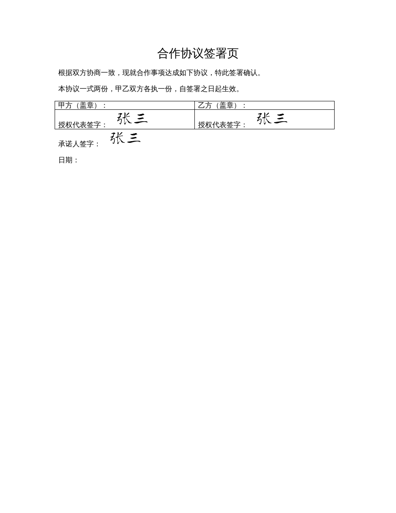

# word-font-signature · Word 字体签名

一个 AI Agent 技能（Skill）：把签署内容用**内置手写字体**渲染成透明签名图，自动定位并插入 Word（`.docx`）的签字栏，按合适大小排版，全程保留原文档格式。

> 适用于 WorkBuddy（Antigravity / Gemini）等支持 Skill 的 Agent，也可直接命令行调用。



---

## 这是什么

给它一份 `.docx` 和要签的内容（姓名、或「同意 张三」这类文字），它会：

1. 扫描文档，列出所有候选签字位置（正文段落、表格内单元格都能识别）；
2. 用你选的手写字体把内容渲染成**透明背景**的高清签名图；
3. 按内容长度自适应大小，等比缩放后插入签字位置；
4. 直接在原文档上修改，**不重建文档、不破坏原有格式**。

## 起源与致谢

本项目是在 [**tianhao909/qoderwork-e-signature**](https://github.com/tianhao909/qoderwork-e-signature) 的基础上改造而来，感谢原作者的业务流程设计（定位 → 采集 → 插入 → 验证）。

与原项目的主要差异：

| 维度 | 原项目 qoderwork-e-signature | 本项目 word-font-signature |
|------|------------------------------|----------------------------|
| 运行环境 | QoderWork 专属 | WorkBuddy（Antigravity / Gemini）等通用 Agent |
| 签名采集 | 浏览器 HTML 鼠标手写画板（signature_pad） | 内置手写字体自动渲染，无需手写 |
| 技术栈 | Node.js（docx 重建文档、canvas 渲染） | Python（python-docx + Pillow） |
| 文档处理 | 用 docx-js 重建文档 | 直接在原 `.docx` 上修改，保留原格式 |
| 字体 | 运行时 canvas 备选 | 内置两款手写字体，开箱即用 |

> 原项目的「鼠标手写签名板」交互在本项目中被有意舍弃——本项目面向「按姓名/文字自动出签名」的批量场景。

## 功能特性

- **两款手写字体**：龙藏体（笔画较粗、连笔潇洒）、平方长安（纤细清秀、字形端正），签署前可选。
- **自动定位**：识别「签字 / 签名 / 签章 / signature / 落款」等字样，支持正文与表格内位置，合并单元格自动去重。
- **自适应排版**：按内容长度计算宽度（约每字 26pt，限制 58–150pt），严格等比缩放不变形；4 倍超采样后裁剪到文字边界，清晰无多余留白。
- **批量签署**：
  - 文件夹整批（同一内容签所有文件）；
  - CSV 清单逐文件指定不同内容（如合同 A 签「同意 张灿」、确认单签「李宏伟」）。
- **文末兜底**：文档没有任何签字位置时，自动在末尾空一行、右对齐放置签名（最后一行文字的右下方）。
- **其他**：内联/换行插入、自动填写当天日期、自定义签名宽度、自动跳过 Word 锁文件、单文件失败隔离并汇总。

## 安装

需要 Python 3.8+，安装依赖：

```bash
pip install python-docx pillow
```

作为 Skill 使用时，把整个 `word-font-signature/` 文件夹放到 Agent 的技能目录：

- WorkBuddy 全局：`~/.gemini/antigravity/skills/`（Windows 为 `%USERPROFILE%\.gemini\antigravity\skills\`）
- 项目级：`<项目根>/.agents/skills/`

## 使用

Agent 模式下直接用自然语言即可（例如「帮我签这个文档，名字张三」），Agent 会自动扫描位置、询问字体并完成签署。

命令行模式：

```bash
# 查看内置字体
python3 scripts/sign_docx.py fonts

# 扫描候选签字位置（不修改文档）
python3 scripts/sign_docx.py scan --input "合同.docx"

# 单文档签署（--font 1 龙藏体 / 2 平方长安）
python3 scripts/sign_docx.py sign --input "合同.docx" --name "张三" --font 2

# 一份文档所有签字栏都签
python3 scripts/sign_docx.py sign --input "合同.docx" --name "张三" --all

# 批量：文件夹整批
python3 scripts/sign_docx.py batch --input-dir "待签文件夹" --name "张三" --font 2

# 批量：按 CSV 清单逐文件不同内容
python3 scripts/sign_docx.py batch --manifest "清单.csv" --font 2
```

清单 CSV 格式（UTF-8，两列带表头）：

```csv
文件名,签署内容
合同A.docx,同意 张三
确认单B.docx,李四
```

更多参数（`--index`、`--width`、`--new-line`、`--fill-date`、`--first-only` 等）见 [SKILL.md](SKILL.md) 与 [references/positioning.md](references/positioning.md)。

## 字体与合规说明

- **龙藏体 LongCang**：来自 Google Fonts，SIL Open Font License 1.1，可随本项目分发。
- **平方长安 PingFangChangAnTi**：随仓库附带仅作演示。**分发前请确认该字体的授权协议**；如未获商用/再分发授权，请从 `assets/fonts/` 移除后再发布，或替换为你有权使用的字体（把 `.ttf` 放进 `assets/fonts/` 并在脚本字体注册表登记即可）。

## 限制

- 仅支持 `.docx`；旧版 `.doc` 请先用 Word/WPS 另存为 `.docx`。
- 本工具生成的是**视觉手写签名**，不是带 CA 证书、可加密验签的合规数字电子签名。

## 许可证

- 本项目代码：[MIT License](LICENSE)。
- 字体文件各自遵循其原始许可证（见上节）。
